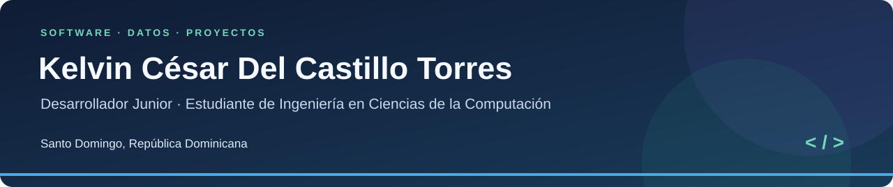

# Kelvin César Del Castillo Torres

Estudio Ingeniería en Ciencias de la Computación en la **Pontificia Universidad Católica Madre y Maestra (PUCMM)**. Me interesa desarrollar software, trabajar con datos y participar en proyectos que conecten la tecnología con necesidades concretas.

En este perfil comparto lo que voy construyendo durante mi formación: ejercicios, proyectos y explicaciones de las decisiones que tomo al resolverlos. También reúno experiencia en soporte técnico, investigación y coordinación de proyectos institucionales.

[Portafolio académico](https://github.com/jokxer8/soluciones-programacion-academica) · [LinkedIn](https://www.linkedin.com/in/jokxer/) · [Contacto](mailto:kelvin.del.castillo@gmail.com)

---

## Mi recorrido académico

El [portafolio](https://github.com/jokxer8/soluciones-programacion-academica) reúne **seis materias y 39 actividades**. Las organicé siguiendo el recorrido desde la representación de datos y los primeros programas hasta el diseño de algoritmos y las aplicaciones con bases de datos.

| Materia | Qué trabajé |
|---|---|
| [00 · Fundamentos de Sistema Computacionales](https://github.com/jokxer8/soluciones-programacion-academica/tree/main/00-fundamentos-sistemas-computacionales) | Bases numéricas, C, ensamblador, memoria dinámica y estructuras enlazadas. |
| [01 · Fundamentos de Programación](https://github.com/jokxer8/soluciones-programacion-academica/tree/main/01-fundamentos-programacion) | Lógica, decisiones, ciclos, arreglos, cadenas y métodos en C#. |
| [02 · Programación Orientada a Objetos](https://github.com/jokxer8/soluciones-programacion-academica/tree/main/02-programacion-orientada-a-objetos) | Clases, encapsulación, composición, herencia, polimorfismo y archivos. |
| [03 · Diseño y Análisis de Algoritmos](https://github.com/jokxer8/soluciones-programacion-academica/tree/main/03-diseno-y-analisis-de-algoritmos) | Búsqueda, ordenamiento, recursión, programación dinámica y análisis de complejidad. |
| [04 · Fundamentos de Programación con SML](https://github.com/jokxer8/soluciones-programacion-academica/tree/main/04-fundamentos-programacion-sml) | Programación funcional, cálculo lambda, inferencia de tipos, módulos y secuencias. |
| [05 · Bases de Datos](https://github.com/jokxer8/soluciones-programacion-academica/tree/main/05-bases-de-datos) | Modelado, normalización, consultas SQL y un proyecto de reservas de hotel. |

Cada actividad tiene una explicación y una guía de desarrollo, junto con el código o los documentos que le corresponden. La [guía de lectura](https://github.com/jokxer8/soluciones-programacion-academica/blob/main/GUIA-DE-LECTURA.md) explica la notación compartida, y la [lista de pendientes](https://github.com/jokxer8/soluciones-programacion-academica/blob/main/PENDIENTES.md) recoge lo que falta por ampliar o comprobar.

---

## Proyectos que puedes explorar

### Sistema de Reservas de Hotel

[Ver proyecto](https://github.com/jokxer8/soluciones-programacion-academica/tree/main/05-bases-de-datos/hotel-reservas-proyecto-final) · [Pruebas funcionales](https://github.com/jokxer8/soluciones-programacion-academica/blob/main/05-bases-de-datos/hotel-reservas-proyecto-final/docs/PRUEBAS-FUNCIONALES.md) · [Tablero](https://github.com/users/jokxer8/projects/1)

Proyecto final realizado en equipo con **C#, Windows Forms, .NET Framework 4.8 y SQL Server**. Integra clientes, habitaciones, reservas, servicios, facturación, roles y reportes.

La versión publicada incluye compilación automatizada en Windows y **79 pruebas funcionales correctas**, ejecutadas localmente y en GitHub Actions. También incorpora almacenamiento de contraseñas con PBKDF2-SHA256 y migración de las cuentas existentes. Las tareas #1–#8 del tablero están completadas; las posibles ampliaciones, como las pruebas de concurrencia y un recorrido visual completo, se detallan en la documentación.

### Gestión de países en C

[Ver proyecto](https://github.com/jokxer8/soluciones-programacion-academica/tree/main/00-fundamentos-sistemas-computacionales/proyecto-final-paises)

Una aplicación en **C** que carga un conjunto histórico de **227 registros** desde un archivo CSV y los organiza en una lista doblemente enlazada. Permite consultar, insertar, eliminar y ordenar países. En el desarrollo explico la estructura de los nodos y el manejo de memoria; las cifras del archivo pertenecen al conjunto de datos de la actividad y no se presentan como estadísticas actuales.

### Ejercicios equivalentes en C y ensamblador

[Ver ejercicios](https://github.com/jokxer8/soluciones-programacion-academica/tree/main/00-fundamentos-sistemas-computacionales/c-y-ensamblador) · [Resultados en Linux](https://github.com/jokxer8/soluciones-programacion-academica/blob/main/00-fundamentos-sistemas-computacionales/PRUEBAS-LINUX.md)

Doce ejercicios resueltos en **C y FASM** para comparar entrada y salida, decisiones, ciclos y patrones. La batería en Linux registra **132 comparaciones correctas y ninguna fallida**. Son comparaciones de casos y modos de ejecución, no 132 programas distintos. La materia incluye además un [proyecto de integración C/NASM en Windows](https://github.com/jokxer8/soluciones-programacion-academica/tree/main/00-fundamentos-sistemas-computacionales/proyecto-hibrido-c-nasm).

### Transformación Digital TagMalco

[Ver caso de estudio](https://github.com/tagmalco/caso-estudio-transformacion-digital)

Caso de diagnóstico tecnológico, migración de la gestión DNS a Cloudflare y documentación del proyecto. Reúne trabajo de coordinación e implementación orientado a mantener la continuidad de los servicios. El desarrollo web se plantea como una etapa posterior.

Conservo los créditos de los trabajos en equipo. Los informes de cada proyecto explican qué se comprobó y bajo qué condiciones.

---

## Tecnologías y herramientas

Estas son las herramientas que utilizo en mis estudios y en otras actividades de trabajo:

| Área | Tecnologías y herramientas |
|---|---|
| Programación | C, C++, C#, SQL, SML, HTML, Visual Studio y UML. |
| Bases de datos y análisis | SQL Server, Microsoft Access, Power BI y Excel avanzado. |
| Organización y documentación | GitHub, Draw.io, Microsoft Project, Xmind y Notion. |
| Productividad | Office, Canva, Gamma y herramientas de IA como apoyo al trabajo. |
| Soporte técnico | Mantenimiento de equipos, instalación y respaldo operativo. |

## Experiencia

**Ministerio de Interior y Policía** — Encargado de Logística en el área de Reforma Educativa Policial.

**PUCMM · Centro de Estudios Caribeños** — Asistente de investigaciones y soporte en data.

Estas experiencias me han permitido trabajar con información, organizar documentación y coordinar actividades con otras personas, además de atender necesidades de soporte técnico.

## Otras líneas de trabajo

- Plataforma universitaria IPES: seguridad, usuarios, admisión y registro académico.
- Gestión de archivos PDF mediante palabras clave.
- Dashboards de análisis de datos en Power BI.
- Desarrollo web de TagMalco como continuación del diagnóstico y la migración DNS.

Comparto estas líneas como parte de mis intereses y trabajo en desarrollo. Los proyectos que cuentan con documentación pública están enlazados en las secciones anteriores.

---

## Contacto

**kelvin.del.castillo@gmail.com**
